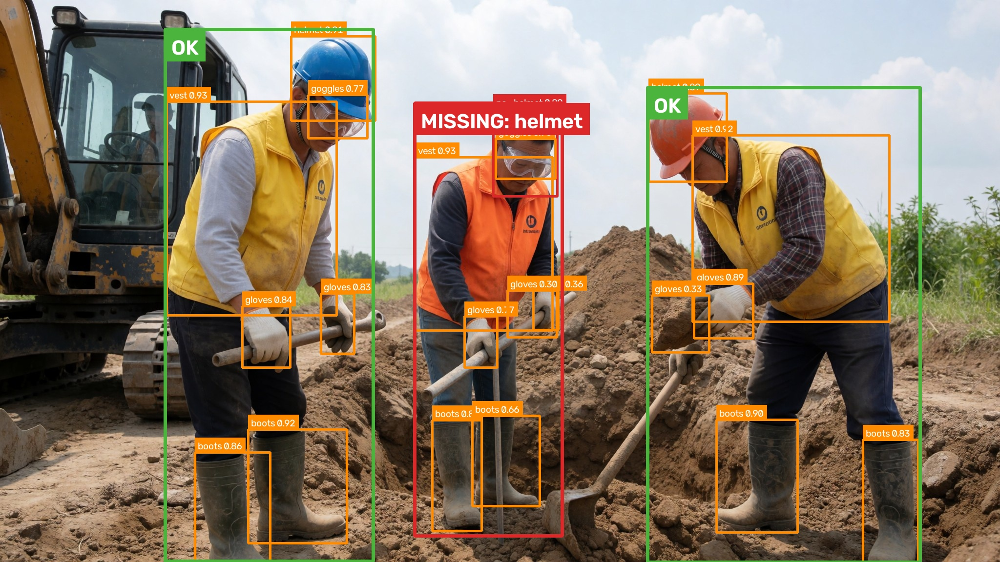
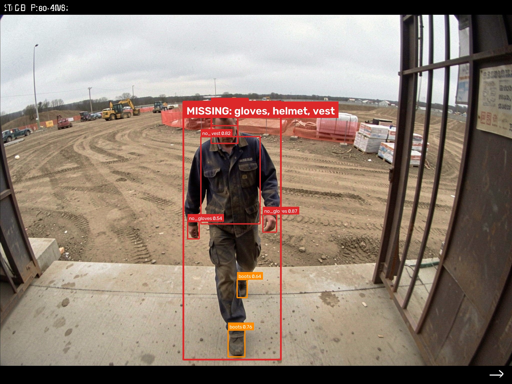
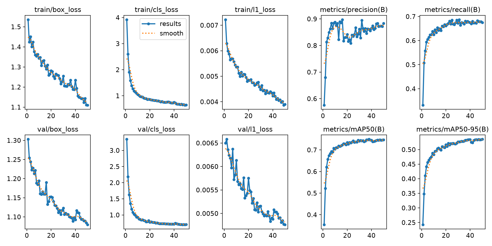
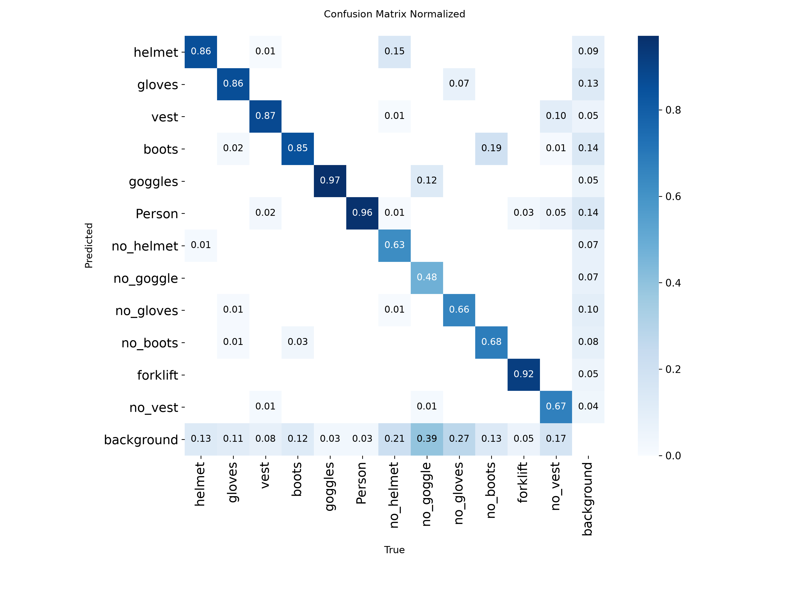

# 🦺 PPE Detection with YOLO

Detects people and their personal protective equipment (PPE) on construction sites, then flags anyone missing a **safety helmet** or **safety vest**.

Built with Ultralytics YOLO, OpenCV and Streamlit. Trained locally on an NVIDIA Quadro P2000 (4 GB).

## How it works

1. A YOLO model (fine-tuned from the pretrained `yolo26n.pt`) detects `Person`, PPE items (`helmet`, `vest`, `gloves`, `boots`, `goggles`), explicit missing-PPE classes (`no_helmet`, `no_vest`, ...), and forklifts.
2. Each PPE detection is assigned to the person box that contains most of it (≥ 50% overlap).
3. A person is **compliant** when both a helmet and a vest are assigned to them and no `no_helmet` / `no_vest` detection is.

## Dataset

[Ultralytics Construction-PPE](https://docs.ultralytics.com/datasets/detect/construction-ppe/): 1,000 images (800 train / 200 val), 12 classes (`helmet`, `gloves`, `vest`, `boots`, `goggles`, `Person`, `no_helmet`, `no_goggle`, `no_gloves`, `no_boots`, `no_vest`, `forklift`), ~14.8k annotations. It downloads automatically into `datasets/` on the first training run.

## Setup (Windows)

```powershell
py -3.12 -m venv .venv
.\.venv\Scripts\activate
pip install torch torchvision --index-url https://download.pytorch.org/whl/cu126
pip install -r requirements.txt
```

> Pascal GPUs (GTX 10xx, Quadro Pxxxx) need the `cu126` PyTorch build. Newer GPUs can use `cu128`.
>
> On Windows 11 with Smart App Control on, pip's `.exe` launchers (`streamlit.exe`, `yolo.exe`) are blocked. Run them through Python instead: `python -m streamlit ...`.

## Usage

```powershell
python train.py                       # train + validate; copies best.pt and plots to the project root
python predict.py sample_images/      # annotated images -> outputs/
python -m streamlit run app.py        # web app at http://localhost:8501
python webcam.py                      # live detection from the laptop camera (Q = quit, S = snapshot)
python webcam.py --source site.mp4 --save outputs/site_annotated.mp4   # annotate a video file
```

## Training configuration

| Setting | Value |
|---|---|
| Base model | yolo26n.pt (pretrained on COCO) |
| Epochs | 50 (early stopping, patience 10) |
| Image size | 640 |
| Batch size | 8 (fits in 4 GB VRAM) |

## Results

Trained for 50 epochs in 57 minutes on a Quadro P2000. Evaluated on the 200 held-out validation images (2,961 objects):

| Metric | Value | Meaning |
|---|---|---|
| Precision | **0.885** | 88.5% of detections are correct |
| Recall | **0.672** | 67.2% of real objects are found |
| mAP50 | **0.745** | detection quality at IoU 0.50 |
| mAP50-95 | **0.535** | detection quality averaged over IoU 0.50–0.95 |

Per-class mAP50 for the classes the compliance check uses:

| Class | mAP50 | Class | mAP50 |
|---|---|---|---|
| Person | 0.940 | no_helmet | 0.645 |
| helmet | 0.840 | no_vest | 0.714 |
| vest | 0.882 | no_goggle | 0.211 (weakest, only 82 examples) |

The model is cautious: high precision but lower recall, so it misses some items rather than inventing them. "Missing" classes are harder than "present" ones, because a bare head is less distinctive than a hard hat.

### Sample predictions

Green = wearing helmet and vest, red = missing equipment. These images are from the validation set, which the model never trained on.




### Training curves and confusion matrix




## Limitations

- Small dataset (800 training images), so accuracy drops on unusual angles, lighting, or crowded scenes.
- Assigning PPE to people relies on box overlap, so it can fail when people overlap each other.
- A person with no helmet/vest detected inside their box is flagged even without an explicit `no_helmet`/`no_vest` detection, so a missed detection shows up as a false "missing" alert.
- Trained on full-body construction-site photos, so close-up webcam views (head and shoulders) are less accurate.
- Each video frame is processed independently, so boxes can flicker between frames (no tracking/smoothing).

## Project structure

```
├── app.py            # Streamlit web app
├── train.py          # training + evaluation
├── predict.py        # batch inference on images
├── webcam.py         # live camera / video file detection
├── ppe_utils.py      # per-person compliance logic + drawing
├── requirements.txt
├── results/          # training plots + sample predictions
├── sample_images/    # test images
└── best.pt           # trained weights
```
